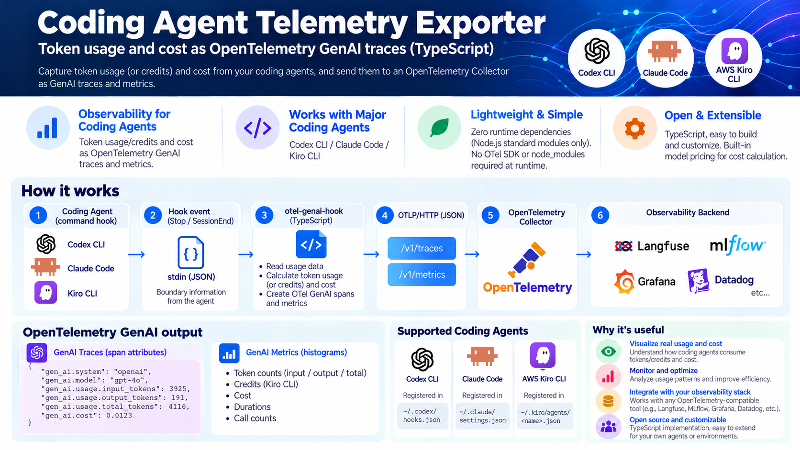

# Coding Agent Telemetry Exporter

Token usage and cost as OTel GenAI traces (TypeScript).



**Supported agents: Codex CLI / Claude Code / Kiro CLI**

Runs as a coding agent's command hook, turning **input / output tokens** (the whole prompt:
system prompt, conversation history, and user prompt) — or **credits**, where that is what the
agent meters — and **cost** into
[OpenTelemetry GenAI semantic conventions](https://opentelemetry.io/docs/specs/semconv/gen-ai/)
span attributes, then sending them to an OTel Collector over OTLP/HTTP. The same
observations also produce the semconv **GenAI metrics** — histograms of token counts,
durations, call counts, and cost.

```
hook event → stdin(JSON) → otel-genai-hook → OTLP/HTTP(JSON) → OTel Collector
                                             (/v1/traces and /v1/metrics)
```

| Agent | Registered in | Usage comes from |
| --- | --- | --- |
| Codex CLI | `~/.codex/hooks.json` | the rollout JSONL's `token_count` records |
| Claude Code | `~/.claude/settings.json` | the transcript JSONL's `message.usage` |
| Kiro CLI | `~/.kiro/agents/<name>.json` | the session store's per-turn credits |

Zero runtime dependencies: `node:*` standard modules only. Neither an OTel SDK nor
`node_modules` is needed at run time; `typescript` and `@types/node` are devDependencies for
building and type-checking. Each CLI waits for the hook command to exit, so keeping startup
cost off the critical path is the priority.

> Claude Code can send OTel traces natively. Running this hook alongside
> `CLAUDE_CODE_ENABLE_TELEMETRY` / `OTEL_LOG_USER_PROMPTS` and friends in the same session
> double-counts everything, so enable only one of the two.

> **Never register two hooks observing the same session.** Tokens and cost would be counted
> twice. `./install.sh --all --uninstall` removes only this hook's entries, so if something was
> registered by another route, delete it by hand from the target file
> (`~/.codex/hooks.json` / `~/.claude/settings.json` / `~/.kiro/agents/<name>.json`).

> **Kiro CLI meters credits, not tokens.** Its service reports what a turn consumed in plan
> credits and leaves the token counts at zero, so the usage attribute to read there is
> `kiro.usage.credits`. See §2, "Kiro CLI".

---

## 1. Why the rollout JSONL is read

The Codex hook payload carries no usage. `Stop` delivers boundary information only:

```
cwd, hook_event_name, last_assistant_message, model, permission_mode,
session_id, stop_hook_active, transcript_path, turn_id
```

Usage lives in the `token_count` records of the rollout JSONL Codex writes itself
(`transcript_path`, usually `~/.codex/sessions/YYYY/MM/DD/rollout-*.jsonl`).

```json
{"type":"event_msg","payload":{"type":"token_count","info":{
  "total_token_usage":{"input_tokens":3925,"cached_input_tokens":0,
                       "output_tokens":191,"reasoning_output_tokens":128,
                       "total_tokens":4116},
  "last_token_usage":{"...the most recent request..."},
  "model_context_window":258400}}}
```

Hence the hybrid design: **boundaries from the hook, usage from the rollout**. On every
`Stop` / `SessionEnd` the rollout is read forward from the previous offset, and each
unprocessed `token_count` becomes one span for one LLM request. The offset lives in a
per-session state file, so no record is counted twice.

> **`last_token_usage` must not be used as-is.** Codex sometimes writes the same
> `token_count` twice (measured: 299 of 598 records repeated the previous
> `total_token_usage`). Summing `last_token_usage` inflates the result exactly twofold.
> This hook derives each request from the **delta** of the monotonically increasing
> `total_token_usage` and discards zero-delta records as duplicates.

The rollout is still being appended to, so a trailing incomplete line is not consumed: the
offset advances byte-wise to the last newline, and the partial line is left for next time.

---

## 2. Building and installing

### 2-1. Build, then install (recommended)

```bash
npm install          # typescript and @types/node, build-time only
npm run build        # → dist/otel-genai-hook.js
./install.sh --codex   # register globally in ~/.codex/hooks.json
./install.sh --claude  # register globally in ~/.claude/settings.json
./install.sh --kiro --agent my-agent  # register in ~/.kiro/agents/my-agent.json
./install.sh --all     # register in all three
```

`npm run build` also copies `pricing.json` into `dist/`, so the built directory is
self-contained: `dist/` alone is enough to run the hook, with the bundled rate table intact.

Building and running this repo's own scripts needs Node >= 22.18 (or >= 23.6), which is what
`package.json` declares — the sources import each other as `./x.ts` and `npm test` runs the
`.ts` files through Node's type stripping. The **compiled** `dist/otel-genai-hook.js` is
plain ES2022 and runs on Node 18.18+, so an older Node can still host the hook if you build
it elsewhere.

### 2-2. Register the `.ts` directly, without building (Node 23.6+ / 22.18+)

Node's type stripping runs `.ts` as-is, so even `npm install` is unnecessary.

```bash
./install.sh --claude --source
```

`install.sh` arguments:

| Argument | Meaning |
| --- | --- |
| `--codex` / `--claude` / `--kiro` / `--all` | What to register. One is required, so nothing is registered by accident |
| `--global` | Register for the user, in `~/.codex` / `~/.claude` / `~/.kiro` (the default) |
| `--project` | Register per project, in `./.codex/hooks.json` |
| `--project --claude` | Register per project, in `./.claude/settings.json` |
| `--agent NAME` | `--kiro` only. Which agent config to patch, creating it if absent. Without it, every config already in the agents directory is patched |
| `--dist` / `--source` | Pin which entry point is registered |
| `--uninstall` | Remove only this hook's entries |
| `--dry-run` | Report what would change without writing anything |
| `--help` | Show the usage summary |

`CODEX_HOME`, `CLAUDE_CONFIG_DIR`, and `KIRO_HOME` override where `--global` writes, and
`NODE=/path/to/node` picks the interpreter to register. The registered command always names
an absolute node path, so it still resolves when the agent is launched from a GUI or from a
shell where nvm / asdf has not run.

An existing target file is merged rather than replaced, never rewritten in place (a temp file
is renamed over it), and a `.bak` copy is kept. The `.bak` is written only when there is not
one already, so it stays the file as it was before this script first touched it rather than
being replaced by an already-patched copy on the next run.

`--uninstall` removes only entries this script wrote, recognized by a command naming the hook
*and* a `--runtime=` flag. It never creates a config file that did not exist, and it removes
the `hooks` key entirely once nothing is left in it. With `--all`, every target is read and
validated before any of them is written, so a syntax error in one config cannot leave the
others half-configured.

**On first launch, Codex asks you to trust the hook.** Codex tracks trust by recording the
hash of the hook command in `[hooks.state]` of `~/.codex/config.toml`, so the hook does not
run until you approve it (the TUI's hook browser can also enable and disable it). Changing
the command string breaks that trust, so switching between `--source` and `--dist` requires
approving again.

Four events are registered with Codex. Claude Code gets those same four plus
`SubagentStop`.

| Event | What it does |
| --- | --- |
| `SessionStart` | Records the session start time and model. On `resume` / `clear`, resets the rollout offset |
| `UserPromptSubmit` | Records the turn start time and, if opted in, the prompt text |
| `Stop` | Reads the rollout forward and sends the LLM request spans and the turn span |
| `SessionEnd` | Collects the LLM requests, tool calls, and turn spans left over after `Stop` |
| `SubagentStop` (Claude) | Reads `agent_transcript_path` and folds the subagent's usage into the parent `prompt_id` |

Tool calls are recovered from the rollout's `function_call` / `function_call_output`, so
there is no need to register `PreToolUse` / `PostToolUse` as well. Kiro CLI is different on
both counts — see §2, "Kiro CLI".

### Claude Code transcript

For Claude Code, the hook's `transcript_path` is read. One assistant API response is split
into several records — one per thinking / text / tool_use block — each repeating the same
`message.id` and usage, so records are grouped by `message.id` into one request.

Usage is converted to the canonical form from `input_tokens`, `cache_read_input_tokens`,
`cache_creation_input_tokens`, and `output_tokens`. The 5-minute and 1-hour cache creation
counts and the thinking tokens are sent as separate attributes.

### Kiro CLI

Kiro CLI declares hooks **inside an agent config**, not in one settings file — and its
built-in `kiro_default` agent carries no config to add them to. So `--kiro` patches the
configs in `~/.kiro/agents` (`./.kiro/agents` with `--project`), and the session has to run on
one of them:

```bash
./install.sh --kiro --agent my-agent   # creates it if it does not exist yet
kiro-cli chat --agent my-agent         # or, once: kiro-cli agent set-default my-agent
```

All five of Kiro's triggers are registered. Unlike the other two agents, tool calls come from
the hooks rather than from a file, because Kiro's own transcript records no per-tool timing.

| Trigger | What it does |
| --- | --- |
| `agentSpawn` | Records the session start and aligns the session-store position, so a resumed session does not replay its history |
| `userPromptSubmit` | Opens a turn (`t1`, `t2`, ...) and, if opted in, records the prompt text |
| `preToolUse` | Opens a tool execution |
| `postToolUse` | Closes it and sends the `execute_tool` span |
| `stop` | Sends the LLM request spans and the turn span, from the session store |

**Anything a Kiro hook prints on stdout is fed back to the model as additional context**, so
this hook prints nothing at all on that path.

#### Why `stop` runs in a detached process

Kiro's hook payload carries no usage — `stop` delivers only `hook_event_name`, `cwd`,
`session_id`, and `assistant_response` — so a turn's totals come from the session state Kiro
writes itself, `~/.kiro/sessions/cli/<session_id>.json`:

```json
{"session_state": {"conversation_metadata": {"user_turn_metadatas": [{
  "total_request_count": 3, "builtin_tool_uses": 2,
  "turn_duration": {"secs": 6, "nanos": 696208620},
  "end_timestamp": "2026-09-17T11:22:02.729244299Z",
  "input_token_count": 0, "output_token_count": 0, "model": "auto",
  "metering_usage": [{"value": 0.047, "unit": "credit"}, {"value": 0.031, ...}]}]}}}
```

**Kiro persists that file only after every `stop` hook has returned** (measured: ~20 ms after
the hook process exited). A `stop` hook can therefore never read its own turn, no matter how
long it waits. So `stop` is handed to a detached copy of the hook, which does the waiting
where Kiro is not waiting on it; the hook Kiro *is* waiting on returns immediately and adds no
latency to the turn. `CAT_OTEL_KIRO_STORE_WAIT_MS` caps that wait, and
`CAT_OTEL_KIRO_DEFER=0` keeps `stop` inline instead — which then blocks the turn for the wait
and still misses the last turn of a session.

If a turn's metadata never shows up, the turn is still reported from what the hooks
themselves saw — the boundary, its duration, its tool calls — with the usage attributes left
off rather than sent as zeros, and `kiro.llm.request.count` absent because the count is
unknown, not zero. No `chat` span is built. The store position does not advance, so usage
that lands later joins the next turn.

#### Credits, not tokens

Kiro's service meters plan **credits** and leaves `input_token_count` / `output_token_count`
at zero, one `metering_usage` entry per request. Credits are neither tokens nor money, so:

- they are reported as they are, on `kiro.usage.credits` and the `kiro.client.credit.usage`
  metric — the one usage figure in this hook that a provider actually measured rather than
  something derived from a rate table;
- the token attributes are **omitted entirely** rather than sent as zeros, which would read as
  "free" instead of "not reported";
- money appears only if you say what a credit costs: `CAT_OTEL_KIRO_CREDIT_USD=0.02` turns
  the credits into `gen_ai.usage.cost.amount` / `kiro.usage.cost`. Unset, no monetary figure
  is invented. Should Kiro ever report token counts, they are priced from `pricing.json` as
  usual, and the per-turn totals are apportioned over the turn's requests by credit share
  (flagged `kiro.usage.tokens.apportioned`).

#### Where the `chat` spans sit

The store summarizes a whole turn, so the per-request boundaries are reconstructed from the
tool executions the hooks timed. An agent loop alternates request → tool batch → request, so
N batches leave N+1 gaps — and `total_request_count` equalled `batches + 1` in every session
measured, with one credit amount per request.

```
turn start ──chat── tool tool ──chat── tool ──chat── turn end
                   └─ batch 1 ─┘      └batch 2┘
```

---

## 3. Span hierarchy

Trace IDs are derived deterministically via SHA-256 from `session_id + turn_id`. The hook
runs in a separate process per event, yet one turn (a user message and its response) still
maps to one trace.

```
invoke_agent codex           ← Stop; the turn's totals and cost
├── chat gpt-5.1-codex       ← one token_count = one LLM request
├── execute_tool exec_command ← one function_call / output pair = one tool execution
└── chat gpt-5.1-codex
```

| Span | `gen_ai.operation.name` | Span kind |
| --- | --- | --- |
| `invoke_agent <agent>` | `invoke_agent` | INTERNAL |
| `chat <model>` | `chat` | CLIENT |
| `execute_tool <name>` | `execute_tool` | INTERNAL |

The kind of span is expressed by `gen_ai.operation.name` alone; there is no custom
`span.kind` attribute. Span names follow semconv: `invoke_agent {gen_ai.agent.name}`.

Codex does not record a per-request start time in the rollout, so a `chat` span's start is
approximated by the end time of the previous request in the same turn, falling back to the
turn's start time.

---

## 4. Attributes and metrics emitted

### Tokens and cost (on the turn span and the LLM request spans)

`gen_ai.*` is a namespace OTel owns, so only attributes defined in the semconv registry go
there; extensions live under `codex.*` / `claude.*`. The one exception is cost, which a draft
still under review puts in the registry — see
[below](#cost-under-gen_ai-implemented-from-an-unmerged-draft).

| Attribute | Contents |
| --- | --- |
| `gen_ai.usage.input_tokens` | Tokens in the whole prompt — **the system prompt (`base_instructions` / AGENTS.md), the conversation so far, and the current user prompt** — exactly the `input_tokens` Codex reports |
| `gen_ai.usage.output_tokens` | Output tokens, reasoning tokens included |
| `gen_ai.usage.reasoning.output_tokens` | The reasoning share of the above (`reasoning_output_tokens`) |
| `gen_ai.usage.cache_read.input_tokens` | The cache-read share of the input above (`cached_input_tokens`). **LLM request spans only** |
| `gen_ai.usage.cache_write.input_tokens` | The cache-write share. **LLM request spans only** |
| `claude.usage.cache_write.5m.input_tokens` / `claude.usage.cache_write.1h.input_tokens` | Per-TTL breakdown of the ephemeral cache. Anthropic-specific and absent from semconv. **LLM request spans only** |
| `codex.usage.uncached_input_tokens` | `input_tokens - cached_input_tokens`: the billable uncached share. **LLM request spans only** |
| `codex.usage.total_tokens` | input + output. Absent from the semconv registry, hence the runtime prefix |
| `codex.usage.cost` | Estimated cost. **An extension attribute, undefined in the released semconv** |
| `codex.usage.input_cost` / `codex.usage.output_cost` | The cost breakdown (the input side already has cache rates applied). Omitted when the amount was metered rather than derived from per-token rates |
| `codex.usage.cost.currency` | Default `USD` |
| `codex.usage.cost.pricing_matched` | `false` signals the model was not in the rate table and `default` rates were used. Omitted for a metered amount, where no rate table applies |
| `kiro.usage.credits` | **Kiro only.** The plan credits the operation consumed, exactly as Kiro metered them. The token attributes above are absent whenever Kiro reported no token counts |
| `kiro.usage.tokens.apportioned` | **Kiro only.** `true` on a `chat` span whose token counts are this hook's credit-weighted share of a per-turn total |
| `gen_ai.usage.cost.amount` | The same cost under the semconv name. **From an unmerged draft; see below. LLM request spans only** |
| `gen_ai.usage.cost.currency` | ISO 4217 code, Conditionally Required by the draft whenever the amount is set. **LLM request spans only** |
| `gen_ai.usage.cost.source` | Always `local`: this hook derives cost from `pricing.json` rather than reading a charged amount off the response. **LLM request spans only** |

#### Cost under `gen_ai.*` (implemented from an unmerged draft)

The released GenAI semconv defines nothing for cost, which is why `codex.usage.cost` /
`claude.usage.cost` exist. A draft is under review that puts it in the registry:

> **[semantic-conventions-genai PR #443](https://github.com/open-telemetry/semantic-conventions-genai/pull/443)** — adds the `gen_ai.usage.cost.amount` / `.currency` / `.source` attributes and the `gen_ai.client.operation.cost` metric.

**The three attributes above and that metric are implemented from that draft, which is not
merged.** The names can still change; `CAT_OTEL_COST_SEMCONV=0` turns them off. The
`codex.*` / `claude.*` cost extensions are emitted regardless, so nothing is lost either
way.

Two points where the draft dictates the behavior:

- **The turn span carries no `gen_ai.usage.cost.*`.** The draft states that on a span
  invoking sub-operations (an agent or workflow span) the attribute records the cost of the
  span's *own* operation and **not** that of its children. A turn's cost is by definition
  the sum of its child `chat` spans, so the total stays on `codex.usage.cost` /
  `claude.usage.cost`, where summing children is this hook's own documented behavior.
- **No cost is emitted when none can be determined.** The draft forbids reporting a cost
  that cannot be determined, so an amount of zero — a model absent from the rate table whose
  `default` rates are also zero, indistinguishable from free — produces neither attributes
  nor a metric point.

`gen_ai.usage.cost.source` distinguishes receiving from deriving: `provider` when the amount
came back in the response, `local` when the emitting component computed it. Neither Codex's
rollout nor Claude Code's transcript reports a charged amount, so this hook is always
`local`. It is the semconv counterpart of `codex.usage.cost.pricing_matched`, which stays on
as the finer signal of *how* the local figure was reached.

A follow-up proposes splitting cost per class:

> **[semantic-conventions-genai issue #484](https://github.com/open-telemetry/semantic-conventions-genai/issues/484)** — `gen_ai.usage.cost.{input,output,cache_read,cache_write,reasoning,tool}`.

`CAT_OTEL_COST_BREAKDOWN=1` emits the four classes this hook can separate —
`gen_ai.usage.cost.input` (the uncached input), `.output`, `.cache_read`, `.cache_write` —
which add up to `gen_ai.usage.cost.amount`. It is **off by default**: that issue is still an
open discussion with its class list unresolved, so it is a step less settled than PR #443.
`reasoning` is not among them because reasoning tokens are billed at the output rate and are
already inside `.output`; `tool` has none, as the tools run locally.

Leaving the cache breakdown off the turn span is what semconv prescribes. It was explicitly
removed from the invoke_agent internal span because a turn's totals span several models and
requests, which makes a cache breakdown misleading. When you need the breakdown, aggregate
it from the child `chat` spans.

### Identity and context

Wherever the semconv registry defines an attribute, that one is used; custom attributes are
limited to **information the registry cannot express**.

| Attribute | Contents |
| --- | --- |
| `gen_ai.operation.name` | `invoke_agent` / `chat` / `execute_tool` |
| `gen_ai.provider.name` | The rollout's `model_provider`, usually `openai`; `anthropic` for Claude Code, `kiro` for Kiro CLI. `kiro` is not one of semconv's well-known values, deliberately: the Kiro service fronts several model families (Claude, DeepSeek, MiniMax, GLM, Qwen), so no upstream provider describes it, and semconv permits a value outside the list |
| `gen_ai.agent.name` | `codex` / `claude-code`; for Kiro, **the agent the session runs** (`kiro_default`, or whatever `~/.kiro/agents/<name>.json` declares), which is the agent in semconv's sense more precisely than the CLI is. **On spans from a subagent, its `agent_type`** (`general-purpose` and the like) |
| `gen_ai.agent.version` | The CLI version (`session_meta.cli_version`). Codex only |
| `gen_ai.conversation.id` | Codex's `session_id` |
| `session.id` | A vendor-neutral identifier that groups per-turn traces into one session |
| `gen_ai.request.model` / `gen_ai.response.model` | Model name. **`chat` / `execute_tool` spans only** (see below) |
| `gen_ai.request.reasoning.level` | `turn_context.effort` (on `chat` spans) |
| `gen_ai.tool.name` / `gen_ai.tool.type` / `gen_ai.tool.call.id` | Tool name, type, and call ID |
| `error.type` | On error only. The value is the well-known fallback `_OTHER`; the message text goes on the span status |

The custom attributes that remain, and why:

| Attribute | Why it stays |
| --- | --- |
| `codex.turn.id` | No `gen_ai.*` attribute identifies a single turn (invocation) |
| `codex.turn.model` | `gen_ai.request.model` is SHOULD NOT populate on a turn span (see below) |
| `codex.model.context_window` | No attribute for a model's context length (`gen_ai.request.max_tokens` is an output cap, a different concept) |
| `codex.llm.request.count` / `codex.tool.call.count` | The same values exist as the `gen_ai.invoke_agent.inference_calls` / `tool_calls` metrics, but there is no span-attribute definition |
| `codex.cwd` / `codex.originator` / `codex.permission_mode` | No attributes for the working directory, the calling UI, or the permission mode |
| `claude.agent.id` | `gen_ai.agent.id` is a stable, provider-issued agent resource ID; putting a transient in-process instance ID there is NOT RECOMMENDED |
| `kiro.llm.request.attempts` | Requests Kiro actually sent, retries included; higher than `kiro.llm.request.count` when a request was retried. No semconv attribute counts attempts |
| `kiro.context.usage_percentage` / `kiro.turn.end_reason` | How full the context window was at the end of the turn, and how the turn ended. Neither has a semconv counterpart |

Leaving `gen_ai.request.model` off the turn span is what semconv prescribes. On an
invoke_agent internal span, `gen_ai.request.model` applies only when the agent is configured
with a single model; for agents with multiple or dynamically chosen models it is SHOULD NOT
populate. A coding agent can switch models mid-session, so the model observed during the
turn is reported as `codex.turn.model` / `claude.turn.model` instead (the
`gen_ai.invoke_agent.*` metrics omit the model attribute for the same reason).

The resource attributes are `service.name` (default `codex` / `claude-code`),
`telemetry.sdk.name`, `telemetry.sdk.language` (`nodejs`), and whatever
`CAT_OTEL_RESOURCE_ATTRIBUTES` (or `OTEL_RESOURCE_ATTRIBUTES`) contains. The configured ones
are also copied onto every metric data point, so a backend that indexes only data point
attributes can still group by them (`CAT_OTEL_METRICS_INCLUDE_RESOURCE_ATTRIBUTES=0` turns
that off). No identity is derived from the rollout; for `user.email` / `enduser.id` see §5,
"Identifying who ran the session".

### Message content (off by default)

Only when `CAT_OTEL_CAPTURE_PROMPTS=1` do the LLM request spans and the turn span carry
`gen_ai.input.messages` / `gen_ai.output.messages` in the semconv v1.37 shape, as a JSON
string. The same setting enables `gen_ai.tool.call.arguments` /
`gen_ai.tool.call.result` on tool spans.

```json
[{"role":"user","parts":[{"type":"text","content":"..."}]}]
```

An LLM request span's input is the system / developer / user / assistant / tool history as
of that call, reconstructed from the rollout; its output is the assistant message and tool
calls that call produced. The turn span carries, as before, `UserPromptSubmit`'s `prompt` as
input and `Stop`'s `last_assistant_message` as output. When an attribute exceeds
`CAT_OTEL_CONTENT_MAX_CHARS`, the oldest history is dropped in favor of the most recent
messages, without breaking the JSON.

### Choosing where attributes go (`CAT_OTEL_MESSAGES_MODE`)

Besides span attributes, the GenAI semconv allows the same information as attributes of the
`gen_ai.client.inference.operation.details` event — not just message content but also the
model name, token counts, and request parameters appear in the event's attribute table.
Message content has different encoding requirements too: on the event it MUST be a
structured value, while on a span a JSON string MAY be used when structured values are
unavailable.

`CAT_OTEL_MESSAGES_MODE` switches the placement of **every attribute the event defines**.

| `CAT_OTEL_MESSAGES_MODE` | Placement | Content encoding |
| --- | --- | --- |
| `attribute` (default) | Everything as span attributes | JSON string |
| `event` | Attributes the event defines move to the trace event | Structured value (`arrayValue` / `kvlistValue`) |
| `both` | Both places | JSON string on the span, structured value on the event |

Here is how this hook's attributes are routed.

| Attribute | Treatment under `event` / `both` |
| --- | --- |
| `gen_ai.operation.name`, `gen_ai.provider.name`, `gen_ai.conversation.id`, `gen_ai.request.model`, `error.type` | Emitted on the event and **kept on the span**, since semconv marks them Required / Conditionally Required there |
| `gen_ai.response.model`, `gen_ai.usage.input_tokens`, `gen_ai.usage.output_tokens`, `gen_ai.usage.reasoning.output_tokens`, `gen_ai.usage.cache_read.input_tokens`, `gen_ai.usage.cache_write.input_tokens`, `gen_ai.request.reasoning.level`, `gen_ai.input.messages`, `gen_ai.output.messages` | Moved to the event; under `event` they leave the span |
| `gen_ai.agent.name` / `gen_ai.agent.version`, `session.id`, `codex.usage.*` / `claude.usage.*` (cost, `total_tokens`, cache TTL breakdown), and the other `codex.*` / `claude.*` | Always span attributes, as the semconv event does not define them |

Attribute names are the same semconv names on the span and on the event. (An alias table
once mapped only the event side to current names; aligning the span side to current names
made it unnecessary.)

So even under `event`, the span keeps the hierarchy, the cost,
`codex.usage.total_tokens`, and the attributes semconv requires on a span — a backend that
only looks at spans can still follow the conversation and the cost.

Under `event` / `both`, each affected span (`chat` and the turn's `invoke_agent`) gains one
trace event, timestamped at the span's end time.

```json
{
  "name": "gen_ai.client.inference.operation.details",
  "timeUnixNano": "...",
  "attributes": [
    { "key": "gen_ai.operation.name", "value": { "stringValue": "chat" } },
    { "key": "gen_ai.provider.name", "value": { "stringValue": "openai" } },
    { "key": "gen_ai.conversation.id", "value": { "stringValue": "..." } },
    { "key": "gen_ai.request.model", "value": { "stringValue": "gpt-5.1-codex" } },
    { "key": "gen_ai.response.model", "value": { "stringValue": "gpt-5.1-codex" } },
    { "key": "gen_ai.request.reasoning.level", "value": { "stringValue": "medium" } },
    { "key": "gen_ai.usage.input_tokens", "value": { "intValue": "10000" } },
    { "key": "gen_ai.usage.output_tokens", "value": { "intValue": "500" } },
    { "key": "gen_ai.usage.cache_read.input_tokens", "value": { "intValue": "8000" } },
    { "key": "gen_ai.usage.reasoning.output_tokens", "value": { "intValue": "300" } },
    { "key": "gen_ai.input.messages", "value": { "arrayValue": { "values": [
      { "kvlistValue": { "values": [
        { "key": "role", "value": { "stringValue": "user" } },
        { "key": "parts", "value": { "arrayValue": { "values": [
          { "kvlistValue": { "values": [
            { "key": "type", "value": { "stringValue": "text" } },
            { "key": "content", "value": { "stringValue": "..." } }
          ] } }
        ] } } }
      ] } }
    ] } } }
  ]
}
```

The event is self-contained with respect to semconv's Required attributes
(`gen_ai.operation.name` and `gen_ai.provider.name`). Tool spans (`execute_tool`) have no
corresponding semconv event, so `gen_ai.tool.*` stays on the span attributes regardless of
placement.

Emitting content requires `CAT_OTEL_CAPTURE_PROMPTS=1` regardless of placement, and
truncation is governed by `CAT_OTEL_CONTENT_MAX_CHARS` in both cases — the event uses the
same limit, measured against the JSON length, dropping the oldest messages first. With
content off (`CAT_OTEL_CAPTURE_PROMPTS=0`), `event` / `both` still emit the model name and
token counts on the event.

> Per semconv, `gen_ai.client.inference.operation.details` is meant to be emitted as a **log
> record**. This hook only sends to `/v1/traces`, so it rides on the corresponding span as a
> trace event (`Span.events`). If your backend only looks at log records, copy the span
> event to a log in the Collector.

### Metrics (`/v1/metrics`)

From the same observations as the spans, the hook builds the metrics the GenAI semconv
defines and sends them to `/v1/metrics` (`CAT_OTEL_METRICS=0` turns this off). All are
histograms, with the bucket boundaries semconv lists as SHOULD.

| Metric | Unit | What it measures | Attributes |
| --- | --- | --- | --- |
| `gen_ai.client.token.usage` | `{token}` | Tokens in one LLM request; two points per `chat` span, input and output | `gen_ai.operation.name` (`chat`), `gen_ai.provider.name`, `gen_ai.request.model`, `gen_ai.response.model`, `gen_ai.token.type` (`input` / `output`) |
| `gen_ai.client.operation.duration` | `s` | `chat` span duration | The above minus `gen_ai.token.type` |
| `gen_ai.client.operation.cost` | `{cost}` | Cost of one LLM request. **From [PR #443](https://github.com/open-telemetry/semantic-conventions-genai/pull/443), unmerged**; `CAT_OTEL_COST_SEMCONV=0` turns it off | The `operation.duration` set plus `gen_ai.usage.cost.currency` (Required) and `gen_ai.usage.cost.source` |
| `gen_ai.invoke_agent.duration` | `s` | Turn span duration | `gen_ai.agent.name`, `error.type` |
| `gen_ai.invoke_agent.inference_calls` | `{inference_call}` | LLM requests in that turn | `gen_ai.agent.name` |
| `gen_ai.invoke_agent.tool_calls` | `{tool_call}` | Tool calls in that turn | `gen_ai.agent.name` |
| `gen_ai.execute_tool.duration` | `s` | `execute_tool` span duration | `gen_ai.tool.name`, `gen_ai.tool.type`, `gen_ai.agent.name`, `error.type` |
| `kiro.client.credit.usage` | `{credit}` | Credits one LLM request consumed. **Kiro only, and an extension**: semconv has no credit metric, and credits fit neither `gen_ai.client.token.usage` nor `gen_ai.client.operation.cost` | The `operation.duration` set |

**Temporality is delta (`aggregationTemporality: 1`).** The hook runs as one process per
event and cannot carry the previous value forward, so cumulative is not an option. Only
what that hook event observed is sent, so sum over time on the backend — even a single turn
arrives in several deliveries, e.g. from `SubagentStop` and then `Stop`.

**Attributes are limited to those semconv defines for each metric.** High-cardinality
identifiers such as `session.id`, `gen_ai.conversation.id`, `codex.*`, `claude.*`, and
`gen_ai.tool.call.id` stay on the span attributes and never reach the metrics, which would
explode the time series. For the same reason `error.type` collapses to the well-known
`_OTHER` rather than the raw error message, and it is absent on success.
`gen_ai.request.model` is left off `gen_ai.invoke_agent.*`, because semconv says it SHOULD
NOT be set for agents with multiple or dynamically chosen models — matching how the turn
span treats it.

On `gen_ai.execute_tool.duration`, `gen_ai.agent.name` is the name of the agent that ran the
tool, exactly as semconv defines it, so tools run by a Claude Code subagent separate out
under an `agent_type` such as `general-purpose`. agent_type is a small fixed set, making it
safe as a metric attribute.

The remaining semconv metrics are outside what this hook can observe.

| Metric not emitted | Why |
| --- | --- |
| `gen_ai.client.operation.time_to_first_chunk` / `time_per_output_chunk` | Per-chunk timestamps are absent from the rollout and the transcript |
| `gen_ai.server.request.duration` / `time_per_output_token` / `time_to_first_token` | Measured server-side, on the inference server |
| `gen_ai.invoke_workflow.duration` | The CLI has no concept matching a workflow |

**The released semconv defines no cost metric.** `gen_ai.client.operation.cost` above comes
from the unmerged [PR #443](https://github.com/open-telemetry/semantic-conventions-genai/pull/443),
which specifies a histogram with unit `{cost}` and the currency in an attribute rather than
in the unit, and no bucket boundaries — so the boundaries used here (a fraction of a cent up
to a few dollars, the range a single coding-agent request falls in) are this hook's own
choice, unlike every other metric above. It is emitted for `chat` spans only, for the reason
[given above](#cost-under-gen_ai-implemented-from-an-unmerged-draft): the turn total is the
sum of its children, which the draft excludes. The per-turn and per-session totals therefore
remain available only as the `codex.usage.cost` / `claude.usage.cost` span attributes.

---

## 5. Configuration

Settings use one `CAT_OTEL_*` namespace across every supported agent.

| Environment variable | Default | Description |
| --- | --- | --- |
| `CAT_OTEL_ENDPOINT` | `http://localhost:4318` | OTLP/HTTP base destination; `/v1/traces` and `/v1/metrics` are appended automatically. Also reads `OTEL_EXPORTER_OTLP_ENDPOINT` |
| `CAT_OTEL_METRICS` | `1` | `0` sends no metrics (traces only) |
| `CAT_OTEL_METRICS_ENDPOINT` | same as `CAT_OTEL_ENDPOINT` | Send metrics to a separate destination. A **full** URL — see below. Also reads `OTEL_EXPORTER_OTLP_METRICS_ENDPOINT` |
| `CAT_OTEL_HEADERS` | — | `k=v,k2=v2`, values percent-encoded — see below. Also reads `OTEL_EXPORTER_OTLP_HEADERS` |
| `CAT_OTEL_TIMEOUT` | `3` | POST timeout in seconds |
| `CAT_OTEL_SERVICE_NAME` | per runtime | `codex`, `claude-code`, or `kiro-cli` |
| `CAT_OTEL_RESOURCE_ATTRIBUTES` | — | Extra resource attributes |
| `CAT_OTEL_METRICS_INCLUDE_RESOURCE_ATTRIBUTES` | `1` | `0` stops copying those attributes onto the metric data points (they stay on the resource). Also reads `OTEL_METRICS_INCLUDE_RESOURCE_ATTRIBUTES` |
| `CAT_OTEL_PRICING_FILE` | the bundled `pricing.json` | Rate table |
| `CAT_OTEL_COST_SEMCONV` | `1` | `0` stops emitting the `gen_ai.usage.cost.*` attributes and the `gen_ai.client.operation.cost` metric of the unmerged [PR #443](https://github.com/open-telemetry/semantic-conventions-genai/pull/443). The `codex.*` / `claude.*` cost extensions are emitted either way |
| `CAT_OTEL_COST_BREAKDOWN` | `0` | `1` adds the per-class breakdown of [issue #484](https://github.com/open-telemetry/semantic-conventions-genai/issues/484) (`gen_ai.usage.cost.input` / `.output` / `.cache_read` / `.cache_write`), whose class list is still an open discussion |
| `CAT_OTEL_CAPTURE_PROMPTS` | `0` | `1` puts prompt and response content on the spans |
| `CAT_OTEL_MESSAGES_MODE` | `attribute` | Where attributes semconv also defines on the event (content, model name, token counts, ...) go: `attribute` (span attributes) / `event` (trace event) / `both`. An unknown value is treated as `attribute` |
| `CAT_OTEL_CONTENT_MAX_CHARS` | `20000` | Per-attribute limit for captured content |
| `CAT_OTEL_STATE_DIR` | per runtime | `~/.codex/otel-genai-hook`, `~/.claude/otel-genai-hook`, or `~/.kiro/otel-genai-hook` |
| `CAT_OTEL_KIRO_CREDIT_USD` | — | Kiro only. What one credit costs. Unset, no monetary cost is reported and only `kiro.usage.credits` is |
| `CAT_OTEL_KIRO_SESSIONS_DIR` | `$KIRO_HOME/sessions/cli` | Kiro only. Where the session store lives; point it at `~/.aws/amazonq/sessions/cli` on the legacy layout |
| `CAT_OTEL_KIRO_STORE_WAIT_MS` | `2000` | Kiro only. How long to wait for the session store to be written after a turn |
| `CAT_OTEL_KIRO_DEFER` | `1` | Kiro only. `0` handles `stop` inline instead of in a detached process, which blocks the turn for the wait above and still misses the last turn |
| `CAT_OTEL_DEBUG` | `0` | `1` logs details to `hook.log` in the state directory |
| `CAT_OTEL_DISABLE` | `0` | `1` does nothing |

The agents' own directory variables are honoured too, and decide where the state directory and
the transcripts are looked for:

| Environment variable | Default | Description |
| --- | --- | --- |
| `CODEX_HOME` | `~/.codex` | Codex CLI's directory |
| `CLAUDE_CONFIG_DIR` | `~/.claude` | Claude Code's directory |
| `KIRO_HOME` | `~/.kiro` | Kiro CLI's directory |
| `CODEX_SESSIONS_DIR` | `$CODEX_HOME/sessions` | Where the rollout is searched for when the payload carries no `transcript_path` |
| `KIRO_SESSION_ID` | set by Kiro CLI | Read, not set: Kiro's `agentSpawn` payload carries no `session_id`, so the hook falls back to what the CLI exports into its environment |

Environment variables are inherited by the hook's child process, so either export them from
`~/.zshrc` or make the registered `command` an `env VAR=... node ...` invocation.

### Endpoints: base versus per-signal

OTLP draws a line this hook follows. A **base** variable is an origin that `/v1/<signal>` is
appended to; a **per-signal** variable is the complete URL and keeps whatever path it carries.

| Variable | Kind |
| --- | --- |
| `CAT_OTEL_ENDPOINT`, `OTEL_EXPORTER_OTLP_ENDPOINT` | base |
| `CAT_OTEL_METRICS_ENDPOINT`, `OTEL_EXPORTER_OTLP_TRACES_ENDPOINT`, `OTEL_EXPORTER_OTLP_METRICS_ENDPOINT` | per-signal |

So a gateway on a custom path works: `OTEL_EXPORTER_OTLP_TRACES_ENDPOINT=https://gw.example.com/otlp-traces`
is used verbatim rather than becoming `.../otlp-traces/v1/traces`. Both kinds stay forgiving
where a path cannot be meant literally — a bare origin still gets `/v1/<signal>` appended, and
a trailing `/v1/<signal>` is normalized to the signal being sent, so pointing the metrics
variable at a URL ending in `/v1/traces` still reaches `/v1/metrics`.

### Headers are percent-encoded

`CAT_OTEL_HEADERS` / `OTEL_EXPORTER_OTLP_HEADERS` follow the OTLP rule that values are
percent-encoded (the W3C Baggage rules), which is the only way to put a `,` or `=` in one.
Values are decoded before being sent; names are used verbatim.

```bash
export CAT_OTEL_HEADERS="Authorization=Bearer%20$TOKEN"   # sends "Bearer <token>"
export CAT_OTEL_HEADERS="x-scope=team%2Cplatform"         # sends "team,platform"
```

A value that is not valid percent-encoding is passed through unchanged rather than dropped, so
a literal `%` in a token still works.

### Identifying who ran the session

Neither the rollout nor the transcript carries an identity, so per-person attribution comes
from the resource attributes. Set them once in your shell:

```bash
export OTEL_RESOURCE_ATTRIBUTES="user.email=$(git config user.email),enduser.id=$(whoami)"
```

`CAT_OTEL_RESOURCE_ATTRIBUTES` takes the same list and wins over `OTEL_RESOURCE_ATTRIBUTES`
when both are set. The parser splits on `,` and on the first `=`, so a value cannot contain a
comma. These are **resource** attributes, so they apply to spans and metrics alike; on top of
that, every metric data point carries a copy, because whether a backend promotes resource
attributes to metric tags is backend-specific. That copy is what makes `sum by (enduser.id)`
work without a Collector rule. Each distinct value is its own time series, so keep the list
to attributes with few values — set `CAT_OTEL_METRICS_INCLUDE_RESOURCE_ATTRIBUTES=0` to send
them on the resource alone. A semconv attribute already on the data point is never
overwritten by a same-named custom one.

Span attributes get no copy: the identity is on the resource the spans belong to.

This is personal data. Enable it only after checking your retention policy; hashing the
address, or using `enduser.id` alone, keeps the grouping without the mail address (see §10).

### Rate table

`pricing.json` is in USD per 1M tokens. Keys resolve in the order **exact match → longest
prefix match → `default`**. By default the file is looked up next to the hook, then in the
parent directory — so both `src/pricing.json` (the checkout) and `dist/pricing.json` (written
by `npm run build`) are found.

```json
{
  "as_of": "2026-09-18",
  "currency": "USD",
  "default": { "input": 1.25, "cached_input": 0.125, "output": 10.0 },
  "per_million_tokens": {
    "claude-sonnet-5": {
      "input": 2.0,
      "cached_input": 0.2,
      "cache_creation_5m": 2.5,
      "cache_creation_1h": 4.0,
      "output": 10.0
    },
    "gpt-5-nano": { "input": 0.05, "cached_input": 0.005, "output": 0.4 }
  }
}
```

Cost is computed as follows, treating `input_tokens` as a total that includes
`cached_input_tokens` **and** `cache_creation_input_tokens`. A cache write is charged at its
own TTL's rate, falling back to `cache_creation` and then to `input` when the table gives no
more specific one.

```
uncached = input_tokens - cached_input_tokens - cache_creation_input_tokens
generic  = cache_creation_input_tokens
         - cache_creation_5m_input_tokens - cache_creation_1h_input_tokens

cost = uncached                        * input             / 1e6
     + cached_input_tokens             * cached_input      / 1e6
     + generic                         * cache_creation    / 1e6
     + cache_creation_5m_input_tokens  * cache_creation_5m / 1e6
     + cache_creation_1h_input_tokens  * cache_creation_1h / 1e6
     + output_tokens                   * output            / 1e6
```

**Keys are version-qualified on purpose.** A family-wide key such as `claude-haiku` prefix-
matches every generation, so it keeps applying one generation's rates after the next one is
priced differently — silently, and reported as `pricing_matched=true` because a key did
match. A model the table does not cover falls to `default` and is flagged
`{runtime}.usage.cost.pricing_matched=false` instead, which is a signal you can alert on.

`as_of` records when the rates were last checked; with `CAT_OTEL_DEBUG=1` the hook notes a
table over 180 days old, since a stale table is the one failure mode a cost figure cannot
signal on its own. **In production, point `CAT_OTEL_PRICING_FILE` at your own organization's
table.** On a flat-rate plan (ChatGPT authentication, a Claude subscription) these figures are
the API-rate equivalent, not what you are actually billed.

---

## 6. Collector side

The GenAI semconv is emitted directly, so no Collector-side conversion is needed. Any
Collector accepting OTLP/HTTP on `/v1/traces` and `/v1/metrics` will take it as-is. A
Collector without a `metrics` pipeline returns 404, in which case either set
`CAT_OTEL_METRICS=0` or point `CAT_OTEL_METRICS_ENDPOINT` elsewhere; export failures are
fail-open, so the session keeps running. The metrics use delta temporality, so a backend
that requires cumulative needs a `deltatocumulative` processor in the Collector.

```bash
export CAT_OTEL_ENDPOINT=http://localhost:4318
codex   # or claude
```

With `CAT_OTEL_CAPTURE_PROMPTS=1` and the default `CAT_OTEL_MESSAGES_MODE=attribute`,
`gen_ai.input.messages` / `gen_ai.output.messages` are emitted as span attributes holding a
**JSON string**. If your backend requires structured values, either add
`ParseJSON(attributes["gen_ai.input.messages"])` in the Collector or set
`CAT_OTEL_MESSAGES_MODE=event` and use the structured value on the trace event (see §4,
"Choosing where attributes go").

---

## 7. Verifying

### 7-1. Self-tests (no agent required)

Against a synthetic rollout and a local OTLP stub, the real hook runs as a subprocess
through `SessionStart → UserPromptSubmit → Stop → SessionEnd`, asserting on the span
structure, tokens, cost (both the extension and the draft `gen_ai.usage.cost.*` names, and
their opt-out and breakdown flags), deduplication, content capture, and metrics (destination
path, units, delta temporality, buckets matching boundaries, attribute cardinality).

The Kiro path is covered against a synthetic session store: the trigger sequence through
`agentSpawn → userPromptSubmit → preToolUse → postToolUse → stop`, the credit attributes and
metric, the request windows falling in the gaps between tool executions, the apportioned token
counts, the resumed-session guard, and the detached `stop` — that one runs the real hook as a
subprocess, asserts it exports nothing itself and prints nothing, then waits for the detached
copy to export once the store appears.

```bash
npm test           # runs src/*.ts directly (Node 23.6+ / 22.18+)
npm run test:dist  # builds first, then checks dist/*.js
npm run typecheck
```

### 7-2. A single manual invocation

```bash
echo '{"hook_event_name":"Stop","session_id":"<session-id>","cwd":"'"$PWD"'",
       "transcript_path":"'"$HOME"'/.codex/sessions/2026/08/25/rollout-....jsonl",
       "model":"gpt-5.1-codex","permission_mode":"default","turn_id":"t1",
       "last_assistant_message":null,"stop_hook_active":false}' \
  | CAT_OTEL_DEBUG=1 node dist/otel-genai-hook.js
# → {"continue":true}
# → export ok ... spans=N and metrics=N in $CODEX_HOME/otel-genai-hook/hook.log
```

### 7-3. Through Codex

```bash
codex                     # run one turn
cat ~/.codex/otel-genai-hook/hook.log
ls  ~/.codex/otel-genai-hook/sessions/
```

If no spans arrive, work through this order:

1. Empty `hook.log` → the hook is not being called. Check trust (`[hooks.state]`) and the
   registration in `hooks.json`
2. `rollout not found` → `transcript_path` is null and no rollout matches `session_id`.
   Check `CODEX_HOME` / `CODEX_SESSIONS_DIR`
3. `export failed` / `export http error` → a Collector-side problem

### 7-4. Through Kiro CLI

```bash
kiro-cli chat --agent my-agent   # the agent whose config the hook was installed into
cat ~/.kiro/otel-genai-hook/hook.log
```

A healthy turn logs `event=stop deferred` (the hook Kiro waits on) followed by
`event=stop spans=N` (the detached copy).

1. Empty `hook.log` → the session is running an agent without the hooks. `kiro-cli chat
   --agent <name>`, and check `/hooks` in the session
2. `session store did not report a turn` → nothing was written to
   `~/.kiro/sessions/cli/<session_id>.json`. Either the session is on `--classic` (not
   covered, see §9) or the store lives elsewhere — set `CAT_OTEL_KIRO_SESSIONS_DIR`
3. Turn spans arrive but carry no cost → expected. Kiro meters credits; set
   `CAT_OTEL_KIRO_CREDIT_USD` to convert them

---

## 8. Implementation notes

| Topic | Implementation |
| --- | --- |
| Runtime | Node 22.18+ / 23.6+ to build and test this repo, or to run `.ts` directly; the compiled `dist/` output runs on Node 18.18+. Zero runtime dependencies |
| Sending | OTLP/HTTP (JSON) POSTed via `node:http` / `node:https`, with an explicit `Content-Length` and a timeout. Traces and metrics are separate signals, so they go in parallel |
| Metric aggregation | Within one hook event, measurements sharing attributes collapse into one data point and are sent as a delta histogram (`count` / `sum` / `min` / `max` / `bucketCounts`). Nothing accumulates across processes |
| Timestamp precision | `Date.now()` (millisecond precision) converted to ns. Timestamps from the rollout are recovered to ns from the ISO 8601 fractional part |
| trace / span IDs | Derived deterministically from the SHA-256 of `codex-otel:<kind>:<identifiers>`. One turn stays one trace despite a separate process per event |
| Content attribute JSON | `JSON.stringify` without whitespace; OTLP attributes carry it as a string |
| ns in the state file | Held as a decimal string, since a `number` lacks ns precision. The reader also accepts numbers |

Source layout:

```
src/otel-genai-hook.ts   Entry point: event handlers and span assembly
src/rollout.ts           Resolving, advancing through, and deduplicating the Codex rollout JSONL
src/claude-transcript.ts Advancing through and deduplicating the Claude transcript and subagents
src/kiro.ts              Kiro's hook triggers: span assembly, tool brackets, deferred stop
src/kiro-session.ts      Advancing through the Kiro CLI session store (per-turn credits)
src/otlp.ts              Assembling and POSTing OTLP/HTTP (JSON)
src/spans.ts             Mapping onto the GenAI semconv (routing attributes and trace events)
src/metrics.ts           Aggregating and sending the GenAI semconv metrics (delta histograms)
src/pricing.ts           Rate table and cost calculation
src/state.ts             Reading and writing session state (atomic rename)
src/ids.ts               Deterministic derivation of trace / span IDs
src/env.ts               Environment variables, state directory, debug log
src/time.ts              Converting between ns timestamps and ISO 8601
src/types.ts             Types for the payload, state, and usage
```

---

## 9. Limitations and known behavior

- **Fail-open.** Whether the Collector is down or the rollout is unreadable, the hook always
  exits 0. The agent's session is never halted.
- **Usage arriving late, after `Stop`** — from an interrupted turn, for instance — lands on
  its `chat` span and in the internal session totals, but is not reflected in the totals of
  the turn span already sent. Turn span IDs are deterministic, so sending a second one
  would be a duplicate.
- **`chat` span IDs are derived from the request, not from a counter.** Claude Code uses the
  Anthropic `message.id`, Codex the `token_count` record's byte offset in the rollout, and Kiro
  the turn plus the request's position in it. A counter in the state file would be handed to
  two concurrent hook processes at once — parallel Claude Code subagents make that routine —
  and they would emit two different spans under one span ID. A session that spans an upgrade
  from before this change will see its `chat` span IDs shift; turn and tool span IDs do not.
- **Concurrent hook processes are serialized on the state file.** Load-modify-save is guarded
  by a lock file, because without it two overlapping processes could each load before the
  other saved and the second write would discard the first — losing a whole subagent's tokens
  and cost. The lock is advisory and given 50 ms: if it cannot be taken the hook proceeds
  anyway, since it must never hold up a turn. The window where an update could still be lost
  is then what it was before, and `CAT_OTEL_DEBUG=1` records it.
- **On older Codex versions every request collapses into one turn.** Only recent versions
  put `turn_id` in `token_count` / `turn_context`; without it the hook falls back to the
  hook payload's `turn_id`.
- **Permission decisions (approval prompts) are out of scope.** Tool calls become
  `execute_tool` spans and `gen_ai.execute_tool.duration`, but on the Codex side only
  `function_call` and `custom_tool_call` are picked up, so MCP tool calls
  (`mcp_tool_call`) are excluded. Claude Code uses `tool_use`, so MCP tools are included
  there.
- **`gen_ai.client.operation.duration` is an approximation.** Neither the rollout nor the
  transcript records a per-request start time, so a `chat` span starts at the end of the
  previous request in the same turn, falling back to the turn's start (see §3). Tool
  execution and time waiting on the user in between are therefore counted in.
- **Sum metrics over time on the backend.** With delta temporality, even one turn arrives
  in several deliveries, e.g. from `SubagentStop` and then `Stop`.
- **The cost metric follows an unmerged draft.** The released semconv defines none, so
  `gen_ai.client.operation.cost` and the `gen_ai.usage.cost.*` attributes are implemented
  from [PR #443](https://github.com/open-telemetry/semantic-conventions-genai/pull/443) and
  may change with it (`CAT_OTEL_COST_SEMCONV=0` opts out). Its bucket boundaries are this
  hook's own choice, and per-turn / per-session cost is not in it: the draft excludes
  children's cost from a parent span, so those totals live only on the `codex.usage.cost` /
  `claude.usage.cost` span attributes.
- **`gen_ai.client.operation.duration` carries no `error.type`.** Per-request failures are
  not observable from the rollout or the transcript, so the attribute cannot be set
  (`gen_ai.execute_tool.duration` and `gen_ai.invoke_agent.duration` do carry it).
- **The semconv event is a trace event, not a log record.** semconv defines
  `gen_ai.client.inference.operation.details` as a log record, but this hook only sends
  traces and metrics, so it rides on the corresponding span as a trace event. Attribute
  names, types, and structure follow semconv.
- **Subagent counts roll up into the parent turn.** semconv says a subagent's inferences and
  tool calls belong to that subagent's own invocation, but this hook creates no
  `invoke_agent` span for a subagent, so `gen_ai.invoke_agent.inference_calls` /
  `tool_calls` are summed into the parent turn (`claude-code`). The spans and the tool
  duration metric do separate per subagent, via `gen_ai.agent.name`.
- **Cost is an estimate.** It is rate-table based and reflects no plan contract, tier, or
  price cut. A span with `codex.usage.cost.pricing_matched=false` had a model name missing
  from the table. Kiro is the exception: its credits are metered by the service, and the only
  local part is the credit-to-money rate you supply.
- **Kiro's usage is not available on the classic UI.** `kiro-cli chat --classic` (the legacy V2
  UI) keeps its conversation state in `~/.local/share/kiro-cli/data.sqlite3` and never writes
  the session store, so credits, cost, and the `chat` spans are all missing there. The turn and
  `execute_tool` spans still arrive, with durations and tool counts, because they come from the
  hooks alone. The default interactive UI and `--no-interactive` both write the session store
  and are fully covered.
- **Kiro reports usage per turn, not per request.** So a `chat` span's window is reconstructed
  from the tool executions around it, and its token counts — when Kiro reports any — are a
  credit-weighted share of the turn total, marked `kiro.usage.tokens.apportioned=true`. The
  credits themselves are exact, one metered amount per request. Its per-turn totals are exact
  as well.
- **A Kiro tool span's duration includes the hook's own startup.** It is measured from
  `preToolUse` to `postToolUse`, each of which starts a Node process; the two startup costs
  largely cancel, leaving an error on the order of tens of milliseconds.

---

## 10. Privacy

By default only metadata and token counts are sent. Setting `CAT_OTEL_CAPTURE_PROMPTS=1`
lets user prompt and assistant response text flow to the Collector; enable it only after
checking your data retention policy. With capture off, the rollout JSONL is merely read —
no conversation content or tool output ever reaches a span.

Note that this path is independent of Codex's own `[otel]` block. Using both observes the
same session through two pipelines, and nothing deduplicates them.
